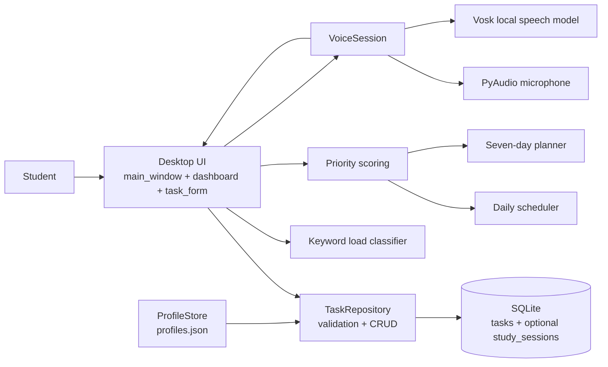

# AuraPlan: project and viva guide

This guide follows the current source code. It distinguishes features that are
visible in the app from backend capabilities that are not yet connected to the
user interface.

## 1. One-minute explanation

AuraPlan is a local desktop study planner. A student enters academic tasks,
deadlines, estimated work times, descriptions, and a mental-load level. The app
uses transparent keyword rules to suggest task load, then a deterministic
priority algorithm combines deadline slack, task duration, mental load, task
status, and the student's selected energy level. A daily scheduler fits work
into the student's available minutes, and a separate seven-day planner spreads
unfinished work across days. Tasks and profiles are stored locally in SQLite
and JSON. Optional speech capture uses Vosk and PyAudio locally; it does not
send audio to a cloud service. The app is built with Python and Tk/CustomTkinter.

The planning and task-load logic is **rule-based, not a machine-learning model
trained on student data**. Vosk is the only pretrained ML component, and it is
used for speech recognition.

## 2. Architecture at a glance



### Main files

| Area | Files | Responsibility |
|---|---|---|
| Entry point | `main.py` | Adds source module folders to Python's import path and starts the app. |
| Window/startup | `app/ui/main_window.py` | Splash/progress UI, profile selection, background loading, navigation, theme, and app shell. |
| Dashboard | `app/ui/dashboard.py` | Today, task-list, and week views; refresh, search/filter, task actions, and voice capture controls. |
| Task editor | `app/ui/task_form.py` | Add/edit form, date/time pickers, load suggestion, validation. |
| Widget compatibility | `app/ui/ui_compat.py` | Uses CustomTkinter if importable; otherwise provides a Tk fallback. |
| Data model/storage | `app/backend/task_model.py`, `database.py`, `task_repository.py`, `schema.sql` | Task object, SQLite setup/migration, validation, and data access. |
| Planning logic | `task_classifier.py`, `priority_engine.py`, `scheduler.py`, `planner.py`, `pattern_analyzer.py` | Explainable classification, ranking, time allocation, and optional history analysis. |
| Profiles | `app/backend/profile_store.py` | Local profile registry and per-profile database paths. |
| Voice | `app/voices/voice_input.py`, `voice_session.py` | Vosk model loading and stoppable microphone transcription. |
| Windows bundle | `AuraPlan.spec`, `build_windows.ps1`, `make_portable_zip.py` | PyInstaller EXE and portable ZIP build. |

## 3. End-to-end app workflow

1. `main.py` establishes the source import paths. In a frozen build, it also
   gives Windows a stable taskbar identity and redirects missing console output
   streams so a windowed EXE can start safely.
2. `AuraPlanApp` creates the root window and a startup screen.
3. A background thread reads or initializes `profiles.json`. The Tk event loop
   polls a thread-safe queue with `after(...)`; background workers do not update
   Tk widgets directly.
4. The app shows the local profile picker. A profile is a name and local data
   namespace, not a login account: there is no password, cloud account, or
   encryption boundary.
5. When a profile is selected, another worker creates a `TaskRepository` for
   that profile's SQLite database. Startup then checks the PyAudio/Vosk runtime
   and checks the expected model files if voice support is installed.
6. The dashboard is constructed and the daily schedule is calculated from the
   current task list, time budget, and energy choice.
7. User actions call repository methods. After task changes or planning-input
   changes, the dashboard schedules a refresh and recalculates the views.

Queues and worker threads keep file/database and large model loading work from
freezing the UI. Tk callbacks and widget updates remain on the Tk event loop.

## 4. Main user workflows

### Add a task

1. Press **Add task**.
2. Enter a non-empty title, choose a deadline date and time, enter an estimated
   number of minutes, and optionally add a description.
3. The form continuously runs the deterministic load classifier and shows a
   reason. `Automatic` accepts the suggestion; High/Medium/Low let the user
   override it.
4. Save validates the title, date/time, and positive duration. The repository
   validates the allowed fields and values again before inserting the row.
5. The dashboard reloads tasks and replans.

### Plan today

The Today view displays open/completed counts, the nearest deadline, a time
budget (default 180 minutes), and Low/Medium/High energy. The UI maps these
choices to energy values 1, 3, and 5. It calls `generate_schedule(...)`, shows
chosen tasks, short/partial blocks, reasons, and deferred work.

### Find and update tasks

My Tasks supports title/description search and All/Pending/Completed filters.
Task cards support edit, completion, and deletion (with a confirmation prompt).
The Week view shows a seven-day allocation and deadline-risk lists.

### Voice quick capture

The user can type into Quick Capture or record speech. Speech is transcribed
offline into the text field; the user reviews it and presses Add task. The
transcript is used as the proposed title in the regular task form. Speech does
not directly create a task without review.

## 5. Task-load classifier

`task_classifier.py` uses fixed keyword groups:

- **High:** words/phrases such as essay, research, exam, programming, proof,
  project, analysis, and problem set.
- **Medium:** read, summarize, practice, prepare, worksheet, and study guide.
- **Low:** organize, submit, upload, email, print, flashcards, and similar
  administrative/light-work terms.

The text is case-folded and tokenized. Matches use word/phrase boundaries, so
`exam` does not match `examined`; a simple optional plural suffix is accepted.
Title matches receive weight 2, while description matches not already counted
in the title receive weight 1. The rule set compares high, medium, and low
weights, with stronger high-load evidence taking precedence in close conflicts.

If no keywords match, duration is used as weak fallback evidence: 90+ minutes
suggests high load, 45+ suggests medium, and a shorter/unknown duration uses a
caller-provided default. The task form uses medium as its default; the public
classifier helper defaults to low. The result includes a level, a reason, and a
confidence label.

**Important:** confidence is a rule-based label, not a measured probability.
There is no training set, neural model, or automatic learning from grades.

## 6. Priority algorithm

`priority_engine.score_breakdown()` is deterministic for a fixed task, current
time, and energy value. It first excludes completed/cancelled tasks. It parses
ISO-formatted deadlines and calculates:

```text
hours_left = deadline - now
slack_hours = hours_left - estimated_minutes / 60
```

Slack is more useful than deadline alone: a 4-hour task due in 5 hours has only
1 hour of slack, while a 20-minute task due in 5 hours has 4 hours 40 minutes.

### Urgency component

The current piecewise urgency rules are:

| Condition | Urgency |
|---|---:|
| Overdue (`hours_left < 0`) | `125 + min(24, overdue_hours / 24)` |
| Not enough time to finish (`slack < 0`) | `113 + min(8, -slack)` |
| Slack up to 24 hours | `100 + (24 - slack) / 24 × 12` |
| Slack up to 72 hours | `70 + (72 - slack) / 48 × 30` |
| Slack up to 168 hours | `35 + (168 - slack) / 96 × 35` |
| More than 168 hours | declines gradually, floored at 0 |
| No deadline | 0 |

The score then adds load points (high 16, medium 11, low 6) and duration
points (`min(minutes, 240) / 60 × 2`, capped at 8). An in-progress task gets
another 8 points. Energy fit adjusts the score: low energy reduces high/medium
work and favors light tasks; high energy slightly boosts high/medium work.

An overdue task or a task whose work estimate exceeds its remaining time is at
risk. Within the 24-hour slack band, slack of six hours or less is also flagged.
The scorer returns numeric components and human-readable reasons for the UI.

### Worked example

Suppose a high-load 90-minute task is due in 6 hours and the selected energy is
Medium (3): slack is 6 - 1.5 = 4.5 hours. Urgency is
`100 + (24 - 4.5) / 24 × 12 = 109.75`. Load adds 16, duration adds 3, and
energy/status add 0, for a total priority score of **128.75**. Because slack is
at most 6 hours, the task is flagged at risk. This number ranks tasks; it is
not a percent chance of completion.

## 7. Daily scheduler

`scheduler.generate_schedule()` performs two ordering stages:

1. Score every active task.
2. For tasks due within 48 hours or overdue, sort first by smallest slack, then
   score and deterministic tie-breakers. This protects the task with the
   tightest deadline/workload fit.
3. Sort other tasks by descending priority score, then deadline, then ID/title.
4. Allocate a task whole if it fits in the remaining minute budget.
5. If it does not fit, allow a partial block only when it is urgent and at
   least 20 minutes remain. Otherwise defer it and continue checking later
   tasks; this lets a shorter task fit after a longer one is deferred.
6. Reorder selected blocks for execution. A task due within 24 hours is first;
   high energy favors high-load work, low energy favors low-load work, and
   medium energy keeps score order.
7. Assign sequential `start_offset_minutes` and return scheduled, deferred,
   at-risk, remaining-minutes, and reason data.

The schedule is generated on demand; it does not write a calendar or reserve
real appointments.

## 8. Seven-day planner

`planner.plan_week()` uses the same priority score but recomputes scores at a
daily timestamp. Today uses the current time; future days use 8:00 AM. The
default horizon is seven days, and the default budget is 180 minutes per day.
Inputs may be one value for every day or a list of per-day budgets/energy.

It allocates up to 90 minutes per pass, and a task is represented at most once
per day. Tasks due on a future date are only eligible through their deadline
day. Already-overdue work remains eligible so it can appear as late work. At
the end, remaining minutes are labeled late or at risk when deadlines fall in
the relevant window. The planner returns a proposal; it does not persist a
calendar entry.

## 9. Data and persistence

### Task data

SQLite `tasks` rows contain: integer ID, title, description, ISO deadline,
estimated minutes, load level, status, optional scheduled date, and created /
updated timestamps. Status values are pending, in-progress, completed, or
cancelled. SQL checks and repository validation prevent blank titles, invalid
load/status strings, negative durations, and malformed dates. Indexes exist on
deadline and status. Each repository operation uses a short-lived connection,
row objects are converted to the `Task` dataclass, and foreign keys plus a
10-second busy timeout are enabled.

The schema initializer upgrades older task tables transactionally so the
medium load value can be accepted without discarding existing rows.

### Profiles and where data lives

`profiles.json` stores profile names and IDs. The Default profile points to the
existing database. Other profiles use separate databases under
`profiles/<profile-id>/auraplan.sqlite3`. The registry is written to a temporary
file and replaced atomically.

- Source run: database beside `app/backend/database.py`.
- Normal EXE: `%LOCALAPPDATA%\AuraPlan\auraplan.sqlite3`.
- Portable ZIP: `data\auraplan.sqlite3` beside the EXE when `portable.mode` is
  present.

These are local-separation features, not cryptographic privacy: profile files
are ordinary local files and are not password-protected or encrypted.

### Study history: implemented API vs current app behavior

The repository can create a `study_sessions` table and exposes methods for
recording/listing sessions and generating behavior recommendations. The
pattern analyzer can compare outcomes by energy, task load, perceived
difficulty, time of day, and planned-vs-actual duration. It requires multiple
observations (default minimum four) and returns evidence counts and heuristic
confidence labels.

At present, the UI does not call `record_study_session()`, so ordinary app use
does not automatically produce this history or show these recommendations.
It is an available backend extension point, not a functioning adaptive learning
loop in the current presentation flow.

## 10. Voice recognition

The EXE includes the Vosk Python runtime and audio dependencies, but not a large
language model. Put the extracted model files in `model\` beside
`AuraPlan.exe`, directly under that folder, so these paths exist:

```text
model\am\final.mdl
model\conf\model.conf
model\graph\HCLG.fst
```

Startup validates the folder and files. A background thread loads the model
after the dashboard is available. During capture, PyAudio reads microphone
frames and `KaldiRecognizer` processes them in Vosk. Recognized phrases are
collected until the user presses Stop; the final partial phrase is included.
Audio resources are stopped and closed in a `finally` block. UI callbacks are
scheduled onto Tk's event loop. If the model/runtime is missing, task planning
still works and voice capture is disabled with a status message.

## 11. Build and distribution

The project is packaged on Windows x64 with Python 3.12 and PyInstaller in
`build_windows.ps1`. `AuraPlan.spec` includes UI/backend module paths, SQLite
schema, icons, CustomTkinter data, and hidden imports for Vosk/audio modules.
The build is an **onedir** bundle: `AuraPlan.exe` plus `_internal` runtime files.
This is more suitable for an adjacent editable Vosk `model` directory than a
single-file executable.

The portable ZIP includes `AuraPlan.exe`, `_internal`, `portable.mode`, and a
model-folder README. It does not include model files unless they are present in
the source `model` folder at build time. Extract the ZIP before running; keep
the whole folder together. The target computer does not need Python installed.
This artifact is for Windows x64, not macOS/Linux or ARM Windows.

To rebuild:

```powershell
.\build_windows.ps1 -Python "C:\Path\To\Python312\python.exe"
```

## 12. What the project does not currently do

- It does not authenticate users, synchronize data to a server, or encrypt
  profile databases.
- It does not learn new keyword weights from task outcomes.
- It does not automatically track elapsed study time or session completion.
- It does not sync to Google/Outlook calendars or create operating-system
  notifications.
- The stored `scheduled_date` field is not currently used to save planner
  results.
- The `in_progress` status is supported by storage/scoring but there is no
  current Start Task control in the dashboard.
- Vosk voice capture requires a compatible model folder and working microphone.

These boundaries are useful to state plainly: AuraPlan currently helps organize
and rank work; it does not guarantee a schedule will be followed or that a task
will be completed on time.

## 13. Likely teacher questions and concise answers

**Is this AI?**
The task-load and scheduling logic is deterministic, explainable rules. Vosk
uses a pretrained speech-recognition model locally. AuraPlan does not train a
model on student data.

**How do you decide what is urgent?**
We calculate slack: time remaining minus estimated task duration. The daily
scheduler protects the smallest slack among tasks due within 48 hours.

**Why include energy?**
Energy is a user-selected preference that changes the order among work types.
It does not override deadline urgency. The UI exposes Low, Medium, and High.

**Why can a task be partially scheduled?**
If an urgent task does not fit completely and at least 20 minutes remain, the
planner assigns a partial block and marks it at risk instead of hiding it.

**How is the classifier evaluated?**
The current classifier is a transparent heuristic. It returns evidence and a
qualitative confidence label, but the project does not currently have a
training/evaluation dataset or calibrated accuracy claim.

**Where is student data stored?**
Locally in SQLite, with a JSON profile registry. Portable mode stores it beside
the EXE. There is no cloud transfer in the current workflow.

**What happens without a voice model?**
All planning/task features still work. Voice capture is disabled until a valid
Vosk model is put in the adjacent `model` directory.

**What is the main next improvement?**
Wire session start/finish events to the existing study-history API, add a UI for
reviewing those records, and test recommendation quality with consented,
privacy-safe sample data. Another priority is validating plans against actual
student schedules and revising rules based on measured results.
